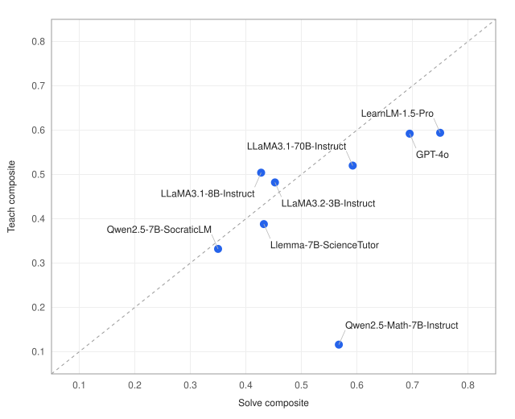

# Teaching-over-Solving Diagnostic

[](https://doi.org/10.5281/zenodo.24430278)

A small tool for one question: **is an LLM tutor as good at teaching as it is
at solving?**

A model that solves math problems well can still be a weak tutor. It may give
away the answer, skip scaffolding, or ignore what the student already knows.
If a benchmark folds everything into one "helpfulness" score, that difference
disappears.

This diagnostic keeps the two apart. From per-task benchmark scores it computes:

- **Solve:** the mean of solving-oriented tasks;
- **Teach:** the mean of pedagogy-oriented tasks;
- **Gap = Teach − Solve:** positive means relatively stronger at teaching.

Across a set of models it also reports how far each model's rank moves between
the two views, the Pearson and Spearman correlations between Solve and Teach,
and a leave-one-out range that shows how fragile those correlations are.

This is the companion tool for *Beyond Helpfulness: A Teaching-over-Solving
Diagnostic for Measuring Educational Impact in LLM Tutors* (5th Workshop on NLP
for Positive Impact, 2026, [OpenReview](https://openreview.net/forum?id=aZ1KTkxECP)).

> **Scope.** This is a descriptive diagnostic on benchmark scores. It does not
> measure student learning. With few models, correlations are fragile, so read
> them together with the leave-one-out range.



## Install

Python 3.10 or newer. No dependencies.

```bash
python -m pip install teaching-over-solving
```

This installs the `tos-diagnostic` command (`teaching-over-solving` also works)
and the `tos_diagnostic` Python package. To work from source:

```bash
git clone https://github.com/Garyouki/teaching-over-solving.git
cd teaching-over-solving
python -m pip install -e ".[dev]"
python -m pytest
```

## Reproduce the paper

```bash
tos-diagnostic paper --report report.md --svg scatter.svg
```

This uses the eight public MathTutorBench leaderboard models bundled with the
package. It reproduces the paper's Table 1 composites, the Spearman correlation
(0.690), the leave-one-out Pearson range (0.251–0.887), and the two rank shifts
the paper describes:

- LLaMA3.1-8B-Instruct rises from rank 7 on solving to rank 4 on teaching
  (gap +0.077).
- Qwen2.5-Math-7B-Instruct falls from rank 4 to rank 8 (gap −0.452).

The exact Pearson correlation is 0.4217. The paper prints it as 0.421.

[examples/paper_report.md](examples/paper_report.md) shows the full report.

## Diagnose your own tutor

### MathTutorBench scores

Put one row per model in a CSV with the nine MathTutorBench task scores. The
leaderboard's own column headers (for example `Problem Solving` or
`Scaffolding (Hard)`) are recognized.

```bash
tos-diagnostic score my_models.csv --reference --report report.md --svg scatter.svg
```

`--reference` places your models next to the eight public models. Scores can
be fractions (`0.64`) or percentages (`64%`).

| Group | MathTutorBench tasks |
|---|---|
| Solve | problem solving, solution correctness, mistake location, mistake correction |
| Teach | Socratic questioning, scaffolding win rate, pedagogy instruction-following win rate, scaffolding (hard), pedagogy instruction-following (hard) |

The paper treats mistake location and mistake correction as solving tasks,
because they test whether the model can find or repair the mathematical state
of the problem.

### Any other benchmark

Name the columns for each side:

```bash
tos-diagnostic score scores.csv --solve accuracy,final_answer \
    --teach scaffolding,guiding_questions,rigor
```

Use this for any benchmark that reports separate solving and teaching scores
per model, including your own internal evaluations.

Missing scores stop the run by default. `--allow-missing` averages the scores
that are present and marks those models in the report.

### Python

```python
from tos_diagnostic import diagnose, load_scores, with_reference

result = diagnose(with_reference(load_scores("my_models.csv")))
for m in result["models"]:
    print(m["model"], round(m["gap"], 3), m["solve_rank"], "->", m["teach_rank"])
```

## Rubric agency density

The paper's second study counts how often tutoring-benchmark rubrics reward
agency-preserving behavior, such as asking guiding questions or giving hints
without revealing the next step. `tos-diagnostic rubrics` computes these
densities from rubric items you have tagged:

```bash
tos-diagnostic rubrics examples/example_rubrics.jsonl
```

The keyword rules are transparent and replaceable. Reading TutorBench's raw
rubric format, and matching the paper's Table 2 exactly, is not yet
re-validated in this package. See [docs/rubric_rules.md](docs/rubric_rules.md).

## Limitations

- Benchmark scores are not learning outcomes. A positive gap does not show that
  a tutor helps students learn more.
- The public leaderboard has only eight models. Removing one model moves the
  Pearson correlation between 0.251 and 0.887.
- Other task groupings are possible. The default grouping is a transparent
  choice, not a definitive taxonomy.
- The diagnostic works on aggregate scores. It does not check answer disclosure
  turn by turn.

## Data

`src/tos_diagnostic/data/mathtutorbench_leaderboard.csv` contains the public
MathTutorBench leaderboard scores for eight models
([Macina et al., EMNLP 2025](https://eth-lre.github.io/mathtutorbench/)). Please
cite MathTutorBench when you use them.

## Citation

```bibtex
@inproceedings{yao2026beyond,
  title     = {Beyond Helpfulness: A Teaching-over-Solving Diagnostic for Measuring Educational Impact in {LLM} Tutors},
  author    = {Junyi Yao and Zihao Zheng and Baichuan Li},
  booktitle = {5th Workshop on NLP for Positive Impact},
  year      = {2026},
  url       = {https://openreview.net/forum?id=aZ1KTkxECP}
}
```

## License

MIT. See [LICENSE](LICENSE).
