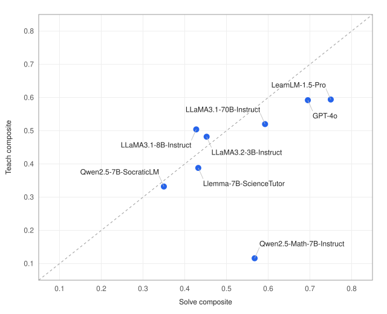

# Teaching-over-solving diagnostic: public MathTutorBench leaderboard

Generated 2026-11-20 with tos-diagnostic 0.1.0. 8 models.

- **Solve** = mean of: `problem_solving`, `solution_correctness`, `mistake_location`, `mistake_correction`
- **Teach** = mean of: `socratic_questioning`, `scaffolding_win_rate`, `pedagogy_if_win_rate`, `scaffolding_hard`, `pedagogy_if_hard`
- **Gap** = Teach − Solve. Positive means relatively stronger at teaching than at solving.

> **Scope.** This is a descriptive diagnostic on benchmark scores. It does not measure student learning, and a small number of models makes the correlations fragile.

## Summary

- Pearson correlation between Solve and Teach: 0.422. Spearman: 0.690.
- Leave-one-out Pearson ranges from 0.251 to 0.887.
- Removing **Qwen2.5-Math-7B-Instruct** changes Pearson the most (to 0.887).
- **Qwen2.5-Math-7B-Instruct** falls from rank 4 on solving to rank 8 on teaching (gap -0.452).
- **LLaMA3.1-8B-Instruct** rises from rank 7 on solving to rank 4 on teaching (gap +0.077).

## Models

| Model | Solve | Teach | Gap | Solve rank | Teach rank | Shift |
|---|---:|---:|---:|---:|---:|---:|
| LLaMA3.1-8B-Instruct | 0.427 | 0.504 | +0.077 | 7 | 4 | +3 |
| LLaMA3.2-3B-Instruct | 0.453 | 0.482 | +0.030 | 5 | 5 | 0 |
| Qwen2.5-7B-SocraticLM | 0.350 | 0.332 | -0.018 | 8 | 7 | +1 |
| Llemma-7B-ScienceTutor | 0.432 | 0.388 | -0.044 | 6 | 6 | 0 |
| LLaMA3.1-70B-Instruct | 0.593 | 0.520 | -0.073 | 3 | 3 | 0 |
| GPT-4o | 0.695 | 0.592 | -0.103 | 2 | 2 | 0 |
| LearnLM-1.5-Pro | 0.750 | 0.594 | -0.156 | 1 | 1 | 0 |
| Qwen2.5-Math-7B-Instruct | 0.568 | 0.116 | -0.452 | 4 | 8 | -4 |

Points below the diagonal are relatively stronger at solving than at teaching.

## How to read this

A strong solver is not automatically a strong tutor. A large negative gap is a flag to check whether the model gives away answers or skips scaffolding when a learner needs support. Report Solve and Teach separately rather than as one helpfulness score.

## Citation

Yao, Zheng, and Li. *Beyond Helpfulness: A Teaching-over-Solving Diagnostic for Measuring Educational Impact in LLM Tutors.* 5th Workshop on NLP for Positive Impact, 2026.
